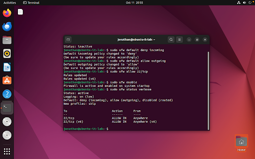
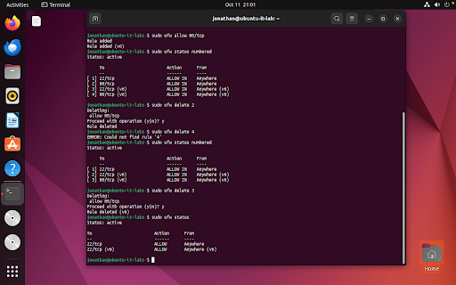
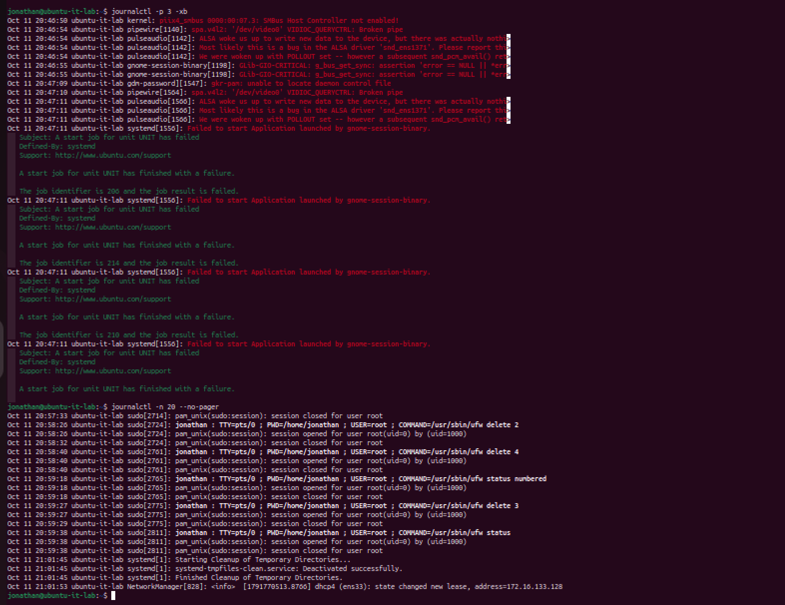
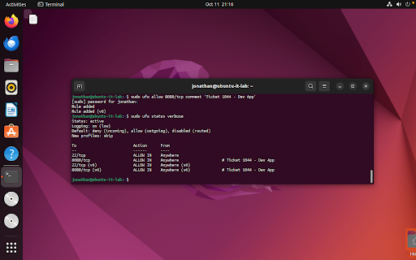
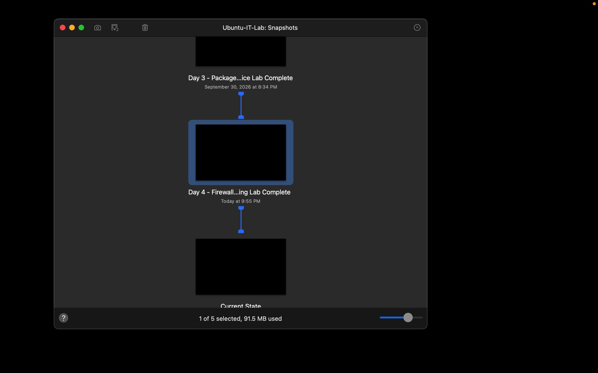

# Day 4 — Linux Firewall Configuration, System Logging, and Port Remediation

**Date:** October 11, 2026  
**Status:** Complete  
**Platform:** VMware Fusion on macOS  
**Virtual machine:** Ubuntu-IT-Lab  
**Operating system:** Ubuntu 22.04.5 LTS  

## Objective

Configure host-based firewall security using `ufw`, establish default traffic policies, manage firewall rule lifecycles, query systemd runtime and error logs with `journalctl`, and resolve a simulated development connectivity outage ticket (#1044).

## Work Completed

- Checked baseline firewall status (`sudo ufw status verbose`).
- Established default network security posture by blocking unsolicited inbound traffic (`sudo ufw default deny incoming`) and allowing outbound connections (`sudo ufw default allow outgoing`).
- Created explicit allow rule for SSH administration on port 22 (`sudo ufw allow 22/tcp`).
- Enabled the Uncomplicated Firewall on system boot (`sudo ufw enable`).
- Managed rule lifecycles and port decommissioning: whitelisted HTTP port 80 (`sudo ufw allow 80/tcp`), listed rules by numerical index (`sudo ufw status numbered`), and cleanly removed IPv4/IPv6 entries (`sudo ufw delete <number>`).
- Queried systemd journal logs to filter high-priority boot errors (`journalctl -p 3 -xb`) and audited recent system session activity (`journalctl -n 20 --no-pager`).
- Resolved Ticket #1044: Remediated internal developer connectivity timeout by allowing TCP port 8080 and attaching an audit comment (`sudo ufw allow 8080/tcp comment 'Ticket 1044 - Dev App'`).

- Created and saved a local lab note:

```text
~/it-labs/linux-basics/notes/day-04-lab.md
```

- Created a VMware Fusion recovery snapshot:
  - `Day 4 - Firewall and Logging Lab Complete`

## Verification

The following commands verified firewall state, rule filtering, log query execution, and ticket resolution:

```bash
# Verify baseline status and default policies
sudo ufw status verbose

# Allow administrative SSH access
sudo ufw allow 22/tcp

# Activate firewall
sudo ufw enable

# Rule lifecycle: allow, index, and delete temporary HTTP rule
sudo ufw allow 80/tcp
sudo ufw status numbered
sudo ufw delete 2
sudo ufw delete 3
sudo ufw status

# Inspect system logs
journalctl -p 3 -xb
journalctl -n 20 --no-pager

# Remediate Ticket #1044 and verify active rule table
sudo ufw allow 8080/tcp comment 'Ticket 1044 - Dev App'
sudo ufw status verbose
```

## Result

Host firewall protection, default inbound blocking, SSH remote access rules, service lifecycle management, and systemd journal log analysis are fully operational, verified, and protected by a VMware recovery snapshot. The VM is secured and ready for future enterprise network and systems administration exercises.

## Skills Practiced

- Host-based firewall configuration and administration (ufw)
- Network traffic security policies (default deny incoming / allow outgoing)
- Rule lifecycle management and index-based rule deletion
- Linux system and service log auditing (journalctl error filtering and session inspection)
- IT Help Desk troubleshooting and service ticket remediation (#1044)
- Technical documentation with Markdown
- Virtual machine snapshot management

## Evidence

### Host firewall activation and default traffic policy


### Rule lifecycle management and numbered deletion


### Systemd log querying and error inspection


### Ticket #1044 resolution and service verification


### VMware Fusion recovery snapshot

