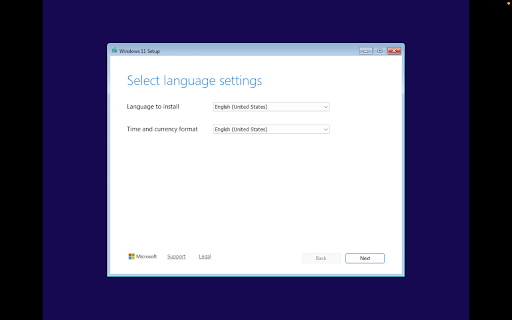
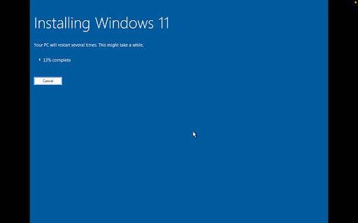
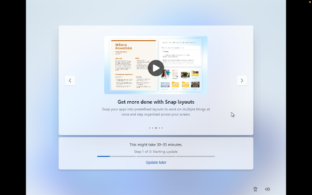
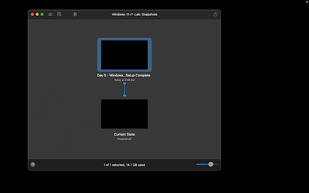

# Day 5 — Windows 11 Virtual Machine Setup and VMware Tools Configuration

**Date:** October 14, 2026  
**Status:** Complete  
**Platform:** VMware Fusion on macOS  
**Virtual machine:** Windows-11-IT-Lab  
**Operating system:** Windows 11 Enterprise Evaluation (64-bit) 

## Objective

Deploy and configure a Windows 11 Enterprise virtual machine within VMware Fusion, configure Virtual Trusted Platform Module (vTPM) and UEFI security requirements, bypass consumer Microsoft account restrictions using a local domain setup, install VMware Tools for hardware graphics acceleration and guest-host integration, and establish a baseline recovery snapshot.

## Work Completed

- Configured virtual machine hardware specifications in VMware Fusion:
  - Firmware: UEFI with Virtual Trusted Platform Module (vTPM) encryption.
  - Compute & Memory: 2 CPU cores, 4 GB RAM.
  - Storage: 64 GB NVMe virtual hard disk.
  - Networking: Shared with Mac (NAT).
- Initialized Windows 11 installation from ISO and selected Windows 11 Enterprise Evaluation.
- Completed custom disk setup on Drive 0 Unallocated Space, allowing the installer to partition system, recovery, and NTFS primary volumes automatically.
- Completed the Windows Out-of-Box Experience (OOBE):
  - Configured regional preferences and US keyboard layouts.
  - Selected domain setup to provision a clean local administrator account without cloud Microsoft 365 account requirements.
  - Configured administrative privacy and diagnostic settings.
- Installed VMware Tools (`setup.exe`):
  - Installed SVGA 30 graphics drivers, mouse synchronization, and shared clipboard drivers.
  - Rebooted the operating system to apply driver configurations and verified dynamic display auto-fitting.
- Cleanly powered down the virtual machine and created a baseline recovery snapshot:
  - `Day 5 — Windows 11 VM Setup Complete`

## Verification

The following verification steps confirmed operating system stability and hypervisor integration:

- Display & Graphics:
  - Verified that screen resolution automatically resizes dynamically when resizing the VMware Fusion window, confirming the VMware SVGA 3D display driver is active.
- Guest Inegration:
  - Verified that the VMware Tools system tray service is running and mouse pointer integration operates smoothly without capture lag.
- Account Provisioning:
  - Confirmed the local administrative profile loads successfully with full desktop and taskbar functionality.
- Disaster Recovery:
  - Verified the snapshot tree hierarchy in VMware Fusion to ensure a clean rollback state before beginning administrative system configurations.

## Result

The Windows 11 Enterprise virtual machine is fully deployed, optimized with VMware Tools guest integration drivers, and secured with a baseline recovery snapshot. Alongside the existing Ubuntu VM, this establishes the foundational dual-OS environment required for cross-platform IT support, Active Directory, PowerShell, and networking labs.

## Skills Practiced

- Enterprise Windows operating system deployment (Windows 11 Enterprise)
- Virtualization hardware security configuration (vTPM, UEFI, NVMe virtualization)
- Account provisioning and Out-of-Box Experience (OOBE) configuration
- Hypervisor guest integration and driver management (VMware Tools)
- Disaster recovery and virtual machine snapshot lifecycle management
- Technical documentation and evidence logging with Markdown

## Evidence

### Windows 11 initial setup and regional configuration

### Operating system deployment and file extraction

### Out-of-Box Experience (OOBE) and setup assistant

### Completed desktop environment and VMware Tools driver verification

### VMware Fusion baseline recovery snapshot

